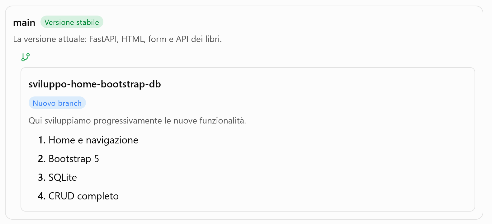

# pitone-borracho-rapido

1. crea l'ambiente virtuale, attivalo e installa le dipendenze (fastapi uvicorn)

       python -m venv venv
       Mac/Linux -> source venv/bin/activate
       Win -> .\venv\Scripts\activate
       pip install fastapi uvicorn

2. scrivi il codice
3. avvio del server

        uvicorn app:app --reload --host 0.0.0.0
        
        -> con --host 0.0.0.0 app ascolta su tutte le interfacce di rete disponibili. Permette di accedere all'app da dispositivi sulla stessa LAN. Tieni d'occhio il Terminale, ti indica su che interfaccia:porta l'app sta ascoltando!

        -> Se invece usi --host 127.0.0.1 o --host localhost l'app è accessibile solo in locale

4. test API
- tutti i libri /libri
- un libro /libro/2
- aggiungi un libro: usa un JSON

        {
            "id": 3,
            "titolo": "Ti con zero",
            "autore": "Italo Calvino"
        }
  oppure usa il form /form
 
5. FastAPI crea la documentazione automatica
- /docs
- /redocs

qui per [altro](https://chatgpt.com/share/6ae843d5-602c-83ed-a05a-ad1a27fe361e)

# pitone-borracho-rapido v.1.1

## Prossimi obiettivi di sviluppo

l'app seguirà questa roadmap di sviluppo

## Roadmap delle prossime versioni

questa è la roadmap delle versioni

## in questa versione 1.1
L'app verrà implementata con
- Home e navigazione
- Bootstrap 5

per procedere lo sviluppo verrà portato avanti in un **nuovo branch**.
1. creo il nuovo branch

        git switch -c sviluppo-home-bootstrap-db

2. pubblico il branch su GitHub

        git push -u origin sviluppo-home-bootstrap-db

verifico il  branch attuale

        git branch

## implementazine Homepage
1. creo cartella *templates* e ci sposto il html esistente (*form.html* che viene rinominato). Inoltre creo *index.html* - Si introduce l'uso di **Bootstrap 5**
2. creo la route per la home page in app.py
3. verifico il funzionamento